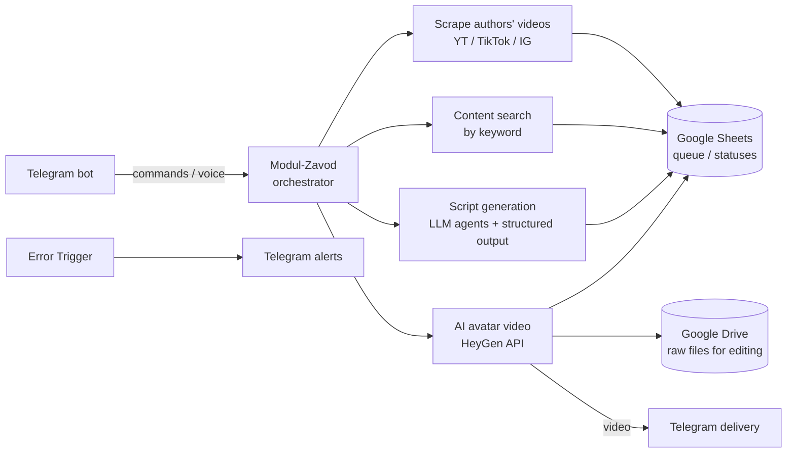
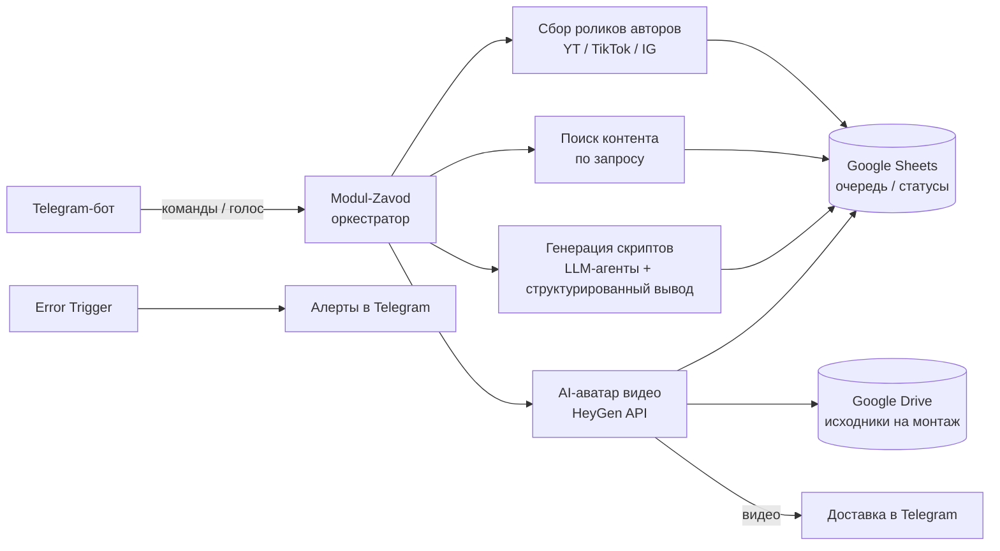

# AI Content Factory for Mascot Videos

Automated production pipeline for short-form AI videos with digital avatars (mascots):
from a brief in Telegram to a finished video ready for editing and delivery.

> **Status: prototype.** The repository contains working n8n workflow definitions
> and integrations. Everything described below as **Implemented** is backed by the
> files in this repository; everything else is explicitly marked **Planned**.


---

## Overview

The Content Factory automates the production of short vertical videos (Reels / Shorts /
TikTok) featuring AI-generated avatar presenters. A Telegram bot acts as the operator
console: it accepts commands, orchestrates sub-workflows, tracks progress through
Google Sheets, and delivers results back to the chat.

The pipeline covers the full production chain:

```
brief (Telegram) → script (LLM agents) → generation (HeyGen avatar video)
→ editing (hand-off to Google Drive) → delivery (Telegram)
```

## Problem

Creating promotional mascot videos by hand took days: writing scripts, recording or
animating a presenter, editing, and shipping each video required a dedicated team and
did not scale. There was no repeatable, tool-agnostic way to turn a content idea into a
finished short video.

## Solution

An n8n-based orchestration layer that combines:

- **Content sourcing** — discovering and ingesting source videos of authors across
  YouTube, TikTok, and Instagram via the scrapecreators API.
- **Script generation** — LLM-powered script writers (Shorts / Reels / TikTok) that
  repurpose source material into platform-specific scripts, with structured output
  parsing and review/rewrite flows.
- **Video generation** — HeyGen avatar generation (avatar + voice + script → 720×1280
  vertical video) with status polling.
- **Operational backbone** — Google Sheets as the queue/state store (statuses such as
  "Create script", "Create AI avatar", "Rewrite", "Done"), Google Drive as the hand-off
  point for editing, Telegram for commands, notifications, and delivery.
- **Error handling** — a global error workflow that alerts the operator in Telegram.

## Key capabilities

*Implemented (present in this repository):*

- **Telegram operator bot** (`Modul-Zavod.json`) — command routing (`/start`, `/search`,
  `/find`, `/scrape`, `/script`, `/avatar`, `/assistant`, `/veo3`, `/yt_script`,
  `/regenerate`), voice-message transcription, sub-workflow orchestration, and
  LLM-driven assistant responses with conversation memory.
- **Author & content scraping** (`Scrape-authors`, `Scrape Instagram accounts`,
  `Content-search.json`) — pull authors' videos from YouTube, TikTok, and Instagram;
  find similar Instagram accounts; search content by keyword across TikTok and
  YouTube Shorts; all written into Google Sheets with per-row status tracking.
- **Script factory** (`CREATE a Script.json`, `Create scripts from URL YouTube video`) —
  fetch transcripts (YouTube / TikTok / Instagram) and generate Shorts, Reels, and
  TikTok scripts via dedicated LLM agents (OpenAI, Google Gemini), with structured
  output parsers and Google Sheets write-back.
- **AI avatar video generation** (`Create AI-avatar video`) — HeyGen `v2/video/generate`
  with configurable avatar, voice, script, and speed; `video_status` polling; video
  download; upload of raw files to a Google Drive folder designated for editing;
  status update back to Sheets.
- **Alerting** (`Errors and bugs notification`) — global n8n error trigger forwarding
  failures to Telegram.

## Architecture



## Tech stack

| Layer | Technology |
|---|---|
| Orchestration | n8n (8 exported workflows) |
| Video generation | HeyGen API (`v2/video/generate`, `v1/video_status.get`) |
| Content data | scrapecreators API (YouTube, TikTok, Instagram) |
| LLM | OpenAI (GPT-5 family), Google Gemini; Anthropic Claude present but disabled |
| State / queue | Google Sheets (status-driven pipeline) |
| File hand-off | Google Drive |
| Interface | Telegram Bot API |
| Agent tooling | n8n AI Agent nodes, structured output parsers, execute-workflow subcalls |

## Project status

**Prototype.** The repository contains the workflow definitions (n8n JSON exports) and
the integration contracts; it is not a packaged application. There is no test suite,
CI, or deployment tooling in the repository.

### Implemented

- 8 n8n workflows covering: orchestration, author scraping, keyword search, similar-account
  discovery, script generation (3 platforms), YouTube-URL script generation, HeyGen avatar
  video generation, and error alerting.
- Google Sheets status model driving the queue (`Create script` → `Create AI avatar` →
  `Done`, plus `Rewrite` and `Find similar` states).
- Telegram bot with command routing, voice transcription, notifications, and result delivery.

### Planned / not implemented

- **Automated editing** — raw files are uploaded to a Google Drive folder for editing;
  the editing step itself (captions, cuts, b-roll) is manual. Tools such as Submagic are
  **not** present in this repository.
- **Publishing to social platforms** — the pipeline currently delivers videos via
  Telegram; no publishing workflow to Instagram/TikTok/YouTube exists in the repo.
- **RAG / mascot template knowledge base** — the current memory is a short-term buffer;
  no vector store or retrieval layer is implemented.
- **Throughput guarantees** — the pipeline is designed to run unattended and **can
  generate up to 3–10 videos per day** and **scan thousands of source videos per search
  query**; these are design capabilities of the pipeline, not measured results
  (no metrics or run logs are stored in this repository).

## My contribution

Designed the pipeline architecture (brief → script → generation → editing hand-off →
delivery) and implemented the n8n workflows and integrations: Telegram orchestration,
content scraping, LLM script-generation agents, HeyGen avatar generation, and the
Google Sheets/Drive operational backbone.

## Quick start

1. Self-host n8n (or use n8n Cloud).
2. Import the exported workflows from this repository into n8n.
3. Configure credentials in n8n: Telegram bot, Google Sheets + Google Drive (OAuth),
   scrapecreators, HeyGen, OpenAI / Gemini.
4. Prepare the Google Sheets tables with the columns used by the workflows
   (e.g. `Источник`, `Название`, `Скрипт`, `Статус`, `Ссылка на видео`, `ID поста`).
5. Activate `Modul-Zavod` first, then the sub-workflows; use `/start` in Telegram to verify.

## Configuration

All secrets live in n8n credentials (values are masked as `[скрыто]` in the exports).
The following items must be configured per environment:

| Variable / credential | Purpose |
|---|---|
| `TELEGRAM_BOT_TOKEN` | Telegram bot for commands and delivery |
| `SCRAPECREATORS_API_KEY` | YouTube / TikTok / Instagram data |
| `HEYGEN_API_KEY`, avatar ID, voice ID | Avatar video generation |
| `OPENAI_API_KEY` / Gemini key | LLM script generation |
| Google Sheets / Drive OAuth | Queue/state store and file hand-off |

## Limitations

- Prototype status: workflows are operated manually via Telegram commands; no tests or CI.
- External API dependencies (scrapecreators, HeyGen) — quotas, cost, and terms apply;
  pipeline throughput is bounded by them.
- Editing is a manual hand-off (Google Drive), not an automated step.
- No social publishing workflow in this repository.
- One workflow node (`Send a video`) and the Anthropic model node are disabled.

## Roadmap

- Automated editing step (captions, cuts) to close the gap between generation and delivery.
- Publishing workflow to social platforms (Instagram, TikTok, YouTube).
- Retrieval layer (RAG) over a mascot/brand template base for personalization.
- Operator dashboard with pipeline metrics (videos produced, per-stage timing, API costs).

## License

Not specified in this repository.

---

# AI Content Factory для видео с маскотами (RU)

Автоматизированный конвейер производства коротких вертикальных AI-видео с цифровыми
аватарами-маскотами: от брифа в Telegram до готового видео, переданного на монтаж и
доставленного заказчику.

> **Статус: prototype.** В репозитории лежат рабочие определения n8n-воркфлоу и
> контракты интеграций. Всё, что описано как **Реализовано**, подтверждается файлами
> в этом репозитории; остальное явно помечено как **Планируется**.

## Обзор

Контент-завод автоматизирует производство коротких вертикальных роликов (Reels /
Shorts / TikTok) с AI-аватарами в роли ведущих. Telegram-бот выполняет роль пульта
оператора: принимает команды, оркестрирует под-воркфлоу, ведёт очередь и статусы в
Google Sheets и возвращает результат в чат.

Конвейер покрывает всю цепочку производства:

```
бриф (Telegram) → скрипт (LLM-агенты) → генерация (HeyGen-аватар)
→ монтаж (передача в Google Drive) → доставка (Telegram)
```

## Проблема

Ручное производство промо-роликов с маскотами занимало дни: написание скрипта,
запись или анимация ведущего, монтаж и сдача каждого видео требовали отдельной
команды и не масштабировались. Не было повторяемого, независимого от инструментов
способа превратить контент-идею в готовый короткий ролик.

## Решение

Оркестрационный слой на n8n, объединяющий:

- **Сбор контента** — поиск и загрузка роликов авторов на YouTube, TikTok и Instagram
  через API scrapecreators.
- **Генерацию скриптов** — LLM-агенты-сценаристы (Shorts / Reels / TikTok), которые
  перерабатывают исходный материал в скрипты под конкретную платформу, со
  структурированным выводом и потоками ревью/переписывания.
- **Генерацию видео** — HeyGen: аватар + голос + скрипт → вертикальное видео 720×1280
  с опросом статуса генерации.
- **Операционный каркас** — Google Sheets как очередь/хранилище состояний (статусы
  «Создать скрипт», «Создать AI Аватар», «Переписать», «Готово»), Google Drive как
  точка передачи на монтаж, Telegram для команд, уведомлений и доставки.
- **Обработку ошибок** — глобальный error-воркфлоу, уведомляющий оператора в Telegram.

## Ключевые возможности

*Реализовано (подтверждается файлами репозитория):*

- **Telegram-бот-оператор** (`Modul-Zavod.json`) — маршрутизация команд (`/start`,
  `/search`, `/find`, `/scrape`, `/script`, `/avatar`, `/assistant`, `/veo3`,
  `/yt_script`, `/regenerate`), транскрибация голосовых, запуск под-воркфлоу,
  LLM-ассистент с краткосрочной памятью диалога.
- **Сбор авторов и контента** (`Scrape-authors`, `Scrape Instagram accounts`,
  `Content-search.json`) — выгрузка роликов авторов с YouTube, TikTok и Instagram;
  поиск похожих аккаунтов Instagram; поиск контента по ключевым словам в TikTok и
  YouTube Shorts; запись в Google Sheets с постатусным трекингом.
- **Фабрика скриптов** (`CREATE a Script.json`, `Create scripts from URL YouTube video`)
  — получение транскриптов (YouTube / TikTok / Instagram) и генерация скриптов под
  Shorts, Reels и TikTok отдельными LLM-агентами (OpenAI, Google Gemini) со
  структурированным выводом и записью в Google Sheets.
- **Генерация AI-аватар-видео** (`Create AI-avatar video`) — `v2/video/generate` HeyGen
  с настраиваемыми аватаром, голосом, скриптом и скоростью; опрос `video_status`;
  скачивание видео; выгрузка исходников в Google Drive (папка на монтаж); обновление
  статуса в таблице.
- **Алертинг** (`Errors and bugs notification`) — глобальный error-trigger n8n с
  доставкой ошибок в Telegram.

## Архитектура



## Стек

| Слой | Технология |
|---|---|
| Оркестрация | n8n (8 экспортированных воркфлоу) |
| Генерация видео | HeyGen API (`v2/video/generate`, `v1/video_status.get`) |
| Данные контента | API scrapecreators (YouTube, TikTok, Instagram) |
| LLM | OpenAI (GPT-5 family), Google Gemini; Anthropic Claude присутствует, отключён |
| Состояние / очередь | Google Sheets (пайплайн на статусах) |
| Передача файлов | Google Drive |
| Интерфейс | Telegram Bot API |
| Агентный инструментарий | AI Agent-ноды n8n, structured output, execute-workflow |

## Статус проекта

**Prototype.** В репозитории — определения воркфлоу (JSON-экспорты n8n) и контракты
интеграций, а не готовое приложение. Тестов, CI и инструментов деплоя в репозитории нет.

### Реализовано

- 8 воркфлоу n8n: оркестрация, сбор роликов авторов, поиск по ключевым словам, поиск
  похожих аккаунтов, генерация скриптов (3 платформы), скрипты по ссылке YouTube,
  генерация HeyGen-видео, алертинг ошибок.
- Статусная модель Google Sheets как очередь («Создать скрипт» → «Создать AI Аватар» →
  «Готово», плюс «Переписать» и «Найти Похожих»).
- Telegram-бот с роутингом команд, транскрибацией голосовых, уведомлениями и доставкой.

### Планируется / не реализовано

- **Автоматический монтаж** — исходники выгружаются в Google Drive на монтаж; сам
  монтаж (субтитры, склейки, b-roll) ручной. Инструментов типа Submagic в этом
  репозитории **нет**.
- **Публикация в соцсети** — конвейер доставляет видео в Telegram; воркфлоу публикации
  в Instagram/TikTok/YouTube в репозитории нет.
- **RAG / база шаблонов маскотов** — сейчас используется краткосрочная память диалога;
  векторное хранилище и retrieval не реализованы.
- **Гарантии производительности** — пайплайн спроектирован для работы без ручного
  вмешательства и **может генерировать до 3–10 видео в день** и **сканировать тысячи
  исходных видео на один поисковый запрос**; это проектные возможности пайплайна,
  а не измеренные результаты (метрик и логов прогонов в репозитории нет).

## Мой вклад

Спроектировал архитектуру конвейера (бриф → скрипт → генерация → передача на монтаж →
доставка) и реализовал воркфлоу и интеграции n8n: Telegram-оркестрацию, сбор контента,
LLM-агентов генерации скриптов, генерацию HeyGen-аватаров и операционный каркас на
Google Sheets/Drive.

## Быстрый старт

1. Разверните n8n (self-hosted или n8n Cloud).
2. Импортируйте экспортированные воркфлоу из этого репозитория.
3. Настройте credentials в n8n: Telegram-бот, Google Sheets + Google Drive (OAuth),
   scrapecreators, HeyGen, OpenAI / Gemini.
4. Подготовьте таблицы Google Sheets с колонками, используемыми воркфлоу
   (например: `Источник`, `Название`, `Скрипт`, `Статус`, `Ссылка на видео`, `ID поста`).
5. Сначала активируйте `Modul-Zavod`, затем под-воркфлоу; проверьте связку командой
   `/start` в Telegram.

## Конфигурация

Все секреты хранятся в credentials n8n (в экспортах значения замаскированы как
`[скрыто]`). Под каждый окружение настраивается:

| Переменная / credential | Назначение |
|---|---|
| `TELEGRAM_BOT_TOKEN` | Telegram-бот для команд и доставки |
| `SCRAPECREATORS_API_KEY` | Данные YouTube / TikTok / Instagram |
| `HEYGEN_API_KEY`, ID аватара, ID голоса | Генерация видео с аватаром |
| `OPENAI_API_KEY` / ключ Gemini | LLM-генерация скриптов |
| Google Sheets / Drive OAuth | Очередь/состояние и передача файлов |

## Ограничения

- Статус prototype: воркфлоу запускаются вручную командами из Telegram; тестов и CI нет.
- Зависимость от внешних API (scrapecreators, HeyGen) — действуют квоты, стоимость и
  условия; пропускная способность пайплайна ограничена ими.
- Монтаж — ручная передача (Google Drive), а не автоматический шаг.
- Публикация в соцсетях в этом репозитории отсутствует.
- Отключены узел `Send a video` и модель Anthropic.

## Roadmap

- Автоматический шаг монтажа (субтитры, склейки) — закрыть разрыв между генерацией и
  доставкой.
- Воркфлоу публикации в соцсети (Instagram, TikTok, YouTube).
- Retrieval-слой (RAG) по базе шаблонов маскотов/бренда для персонализации.
- Дашборд оператора с метриками пайплайна (выпущено видео, время этапов, стоимость API).

## Лицензия

В репозитории не указана.
